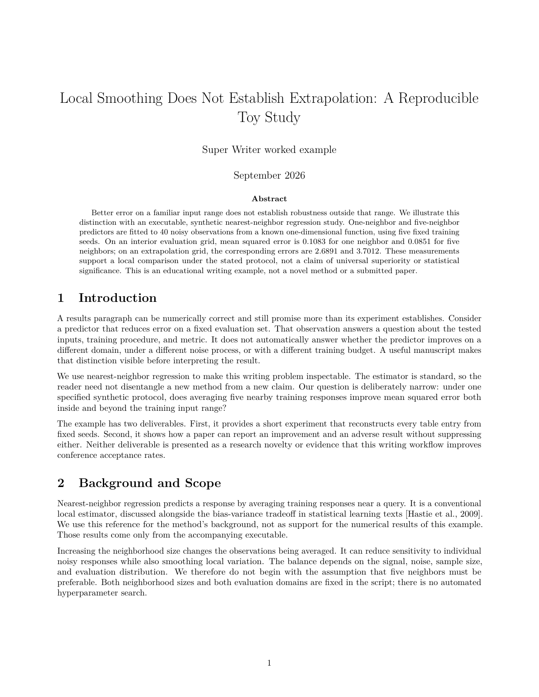
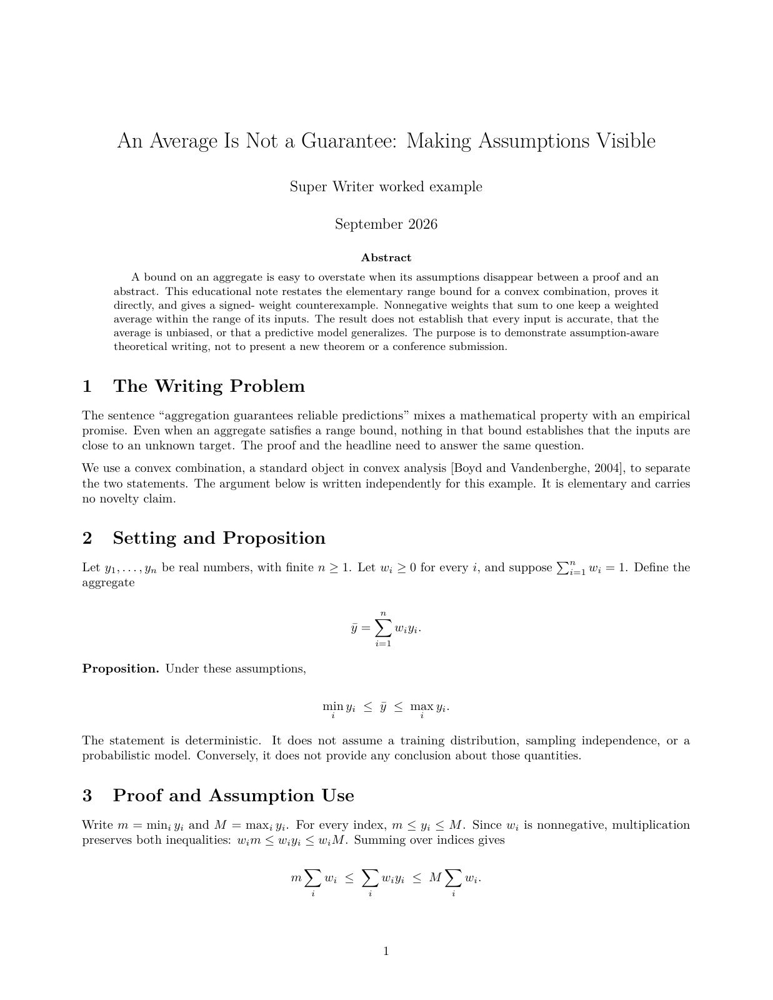
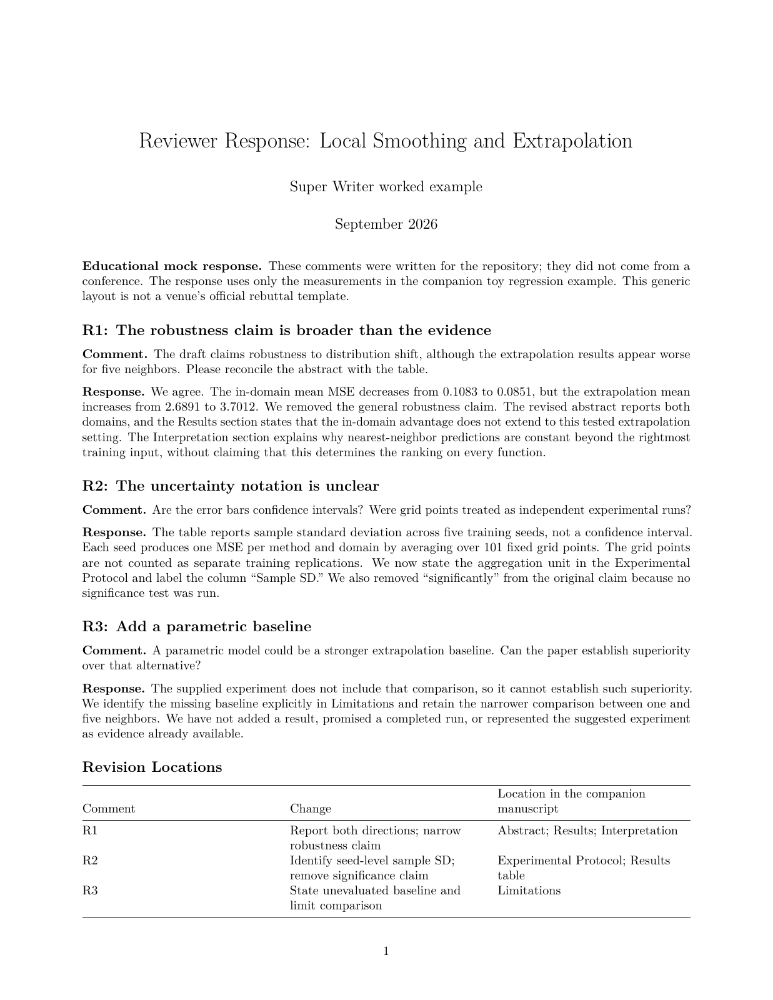
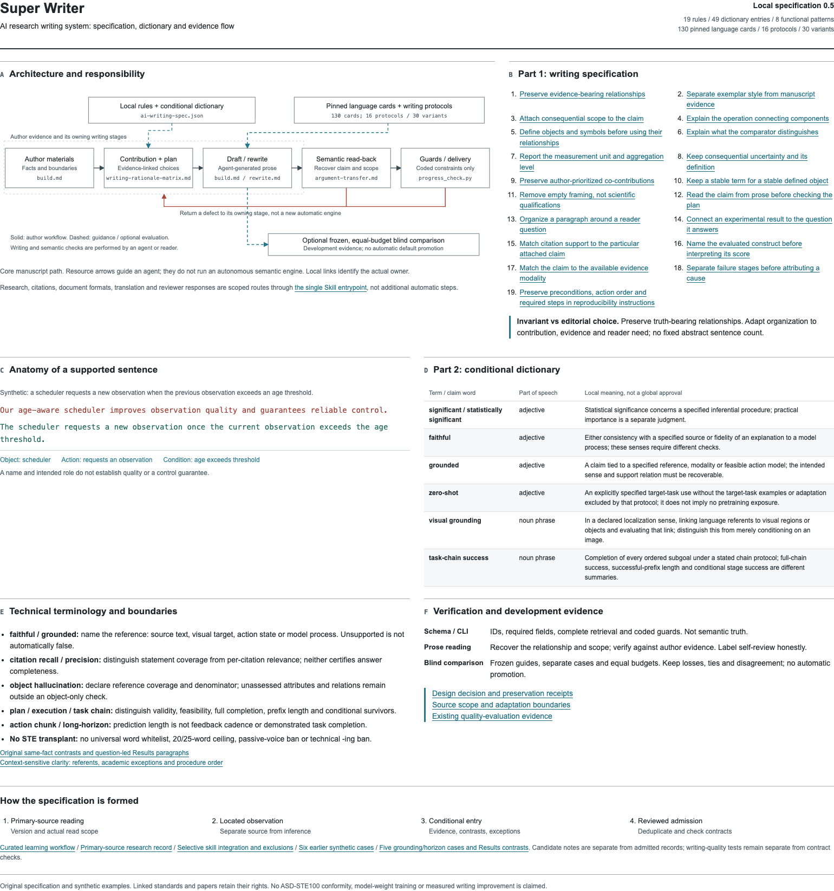
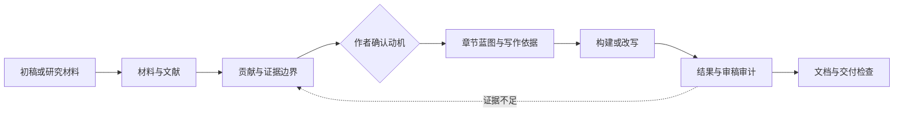

<h1 align="center">Super Writer</h1>
<p align="center"><strong>让论文的每个主张，都有证据和写作理由。</strong></p>
<p align="center">从研究材料到论文初稿、结构性改写与审稿回复的 Agent Skill</p>

<p align="center">中文 · <a href="README.en.md">English</a> · <a href="#examples">看样文</a> · <a href="#quick-start">快速开始</a> · <a href="#verification">验证证据</a> · <a href="SKILL.md">Agent 入口</a></p>

[](https://github.com/asimfish/super_writer/actions/workflows/ci.yml)
[](https://github.com/asimfish/super_writer/releases)
[](LICENSE)
[](DATA_LICENSE)
[](docs/validation.md)
[](https://github.com/asimfish/super_writer/stargazers)

**已有实验、方法和初稿，但论文的贡献还不清楚？** Super Writer 先梳理实际贡献与证据边界，
再设计章节和段落，最后检查引用、结果解释与文档交付。它不是一个只换词的润色提示词，
也不会把缺失的实验写成已完成的结果。

仓库名是 `super_writer`，调用名是 **`$super-writer`**。写作由你使用的 AI agent 执行；
Python 脚本负责可重复的检查。项目不自带模型，不承诺录用或 AI 检测通过。

**最新写作验证：** DROID/SIMPLER 的 12 组对照、24 段成稿中，候选 3 票、基线 10 票、持平 11 票，
**未通过预设门槛，默认规则不变**。指标解释有局部改善，但证据选择与段落衔接仍有退步。
[完整结果和失败分析](docs/ai-spec-pilot-evaluation.md) · [横向对比](evals/ai-spec-pilot/comparison.html)

**机制改进候选：** 新增“选证据 → 绑定对象与对照 → 组织成句 → 成稿读回”的可选流程，
接入现有写作矩阵，不新增必填报告。配套 8 类、16 个反事实开发探针，检验优先级或条件改变时
是否需要改变写法；**尚未执行新模型盲测，不代表效果提升，也未升级默认规则**。
[具体机制与正反边界](references/evidence-link-candidate.md) · [可复现输入与下一轮验证](evals/evidence-link/README.md)

**可选角色协作：** 借鉴 IdeaScientist，把差距诊断、改法提议和正文实现分开，由编排者调度，
gap finder 按当前章节选入优秀论文观察、章节协议、写作规范及语言卡，比较**内容取舍、论证组织、
证据呈现、专业表达、清晰度和适用格式**，不只寻找读不懂的句子。每个选定差距都要对应改法及成稿位置，
审读者再独立检查这些对标项；已有优点和不同但合理的写法也要保留。交接工具检查版本、职责、回退和停止，
不自动调用模型，也不把检查通过当成写作提升。大型想法库用于发现论文的设计已记录，**尚未下载或导入**。
[角色与架构图](docs/system-organization.md#可选角色协作与反馈) ·
[来源核实与奖励适配](docs/research/ideascientist-2026-10-15.md) ·
[原创交接示例](examples/writing-team/README.md) ·
[摘要、相关工作和实验：压缩优先地改进清楚但不够好的写法](examples/writing-team/benchmark.md)

<a id="examples"></a>
## 样文：先看结果

<table>
<tr>
<td width="33%" align="center"><a href="examples/knn-regression/manuscript.pdf"></a></td>
<td width="33%" align="center"><a href="examples/theory-note/manuscript.pdf"></a></td>
<td width="33%" align="center"><a href="examples/review-response/response.pdf"></a></td>
</tr>
<tr>
<td align="center"><strong>可复算实证样文 · 3 页</strong><br><a href="examples/knn-regression/manuscript.md">正文</a> · <a href="examples/knn-regression/manuscript.pdf">PDF</a> · <a href="examples/knn-regression/manuscript.docx">Word</a></td>
<td align="center"><strong>假设与证明短文 · 2 页</strong><br><a href="examples/theory-note/manuscript.md">正文</a> · <a href="examples/theory-note/manuscript.pdf">PDF</a> · <a href="examples/theory-note/manuscript.docx">Word</a></td>
<td align="center"><strong>有依据的审稿回复 · 1 页</strong><br><a href="examples/review-response/response.md">正文</a> · <a href="examples/review-response/response.pdf">PDF</a> · <a href="examples/review-response/response.docx">Word</a></td>
</tr>
</table>

预览直接渲染自仓库中的 PDF，不是效果图。样文是 **AI 辅助编写、据材料核对的教学 worked examples**，
不是真实投稿、录用论文或独立盲测。实证样文的数据生成过程是合成的，但每个表格数字都由公开脚本实际计算；
理论命题是基础知识，审稿意见为构造场景。没有发布私人论文或他人的完整样文。

### 改写不只是换词

| 输入中的过强主张 | 根据材料改写后 |
|---|---|
| “Five-neighbor regression significantly outperforms one-neighbor regression and is robust to distribution shift.” | “On the in-domain grid, five-neighbor regression reduces mean MSE from 0.1083 to 0.0851 across five fixed training seeds. On the extrapolation grid, mean MSE increases from 2.6891 to 3.7012; the in-domain advantage does not extend to this tested setting.” |

改变的是主张范围：保留改善，也保留反向结果；没有做显著性检验，就不写 “significantly”。

[原始材料](examples/knn-regression/materials/) · [实验脚本](examples/knn-regression/experiment.py) ·
[逐段写作依据](examples/knn-regression/writing-decisions.md) · [全部示例与复现](examples/README.md)

<a id="quick-start"></a>
## 快速开始

**需要 Python 3.10+，以及能读取本地 Skill 的 AI agent。** 检查脚本使用 Python 标准库。
Word 导出另需 Pandoc；PDF 编译另需 TeX。只运行检查器，不会自动调用模型写论文。

```bash
git clone https://github.com/asimfish/super_writer.git
cd super_writer
python3 tools/install_skill.py --destination "${CODEX_HOME:-$HOME/.codex}/skills/super-writer"
```

Claude Code 可将目标改为 `"$HOME/.claude/skills/super-writer"`。
Windows 使用 `python` 或 `py -3`，并填写自己的完整目标路径。
安装器拒绝覆盖已有目录；更新时先备份或移走旧安装，保留用户修改。

在新会话中调用：

```text
使用 $super-writer，根据当前目录的 draft.tex、实验表格和方法说明改写会议论文。
先检查材料和已有进度，明确贡献与证据缺口，请我确认研究动机后再设计章节。
保留数字、公式和引用键；目标会议、年份和投稿阶段以我提供的要求为准。
```

只改一个段落也可以：

```text
使用 $super-writer，只审计并改写摘要，不启动整篇论文流程。
列出哪些主张有证据，哪些必须收缩；不要检索文献或补做实验。
```

不使用 Git 时，可从 [Releases](https://github.com/asimfish/super_writer/releases/latest) 下载版本化 Skill ZIP，
解压后的 `super-writer/` 即技能目录。其他 agent 需要支持本地文件读取；执行检查还需要 Python。
[更多提示词与配置](docs/usage.md)

## 适合做什么

| 任务 | 核心动作 | 可检查的产物 |
|---|---|---|
| 从材料构建论文 | 盘点方法、结果、图表与缺口 | 证据库、贡献定义、初稿 |
| 结构性改写 | 分析原逻辑，设计迁移与保留规则 | 改写矩阵、逻辑迁移审计 |
| 贡献与研究定位 | 区分为什么做、做出了什么、证据到哪里 | Contribution、SOTA gap map |
| 学习目标论文写法 | 学论证顺序与证据安排，不复制原句 | 风格 profile、章节蓝图 |
| 引用支持 | 将文献绑定到具体论述，核验元数据 | Citation Support Bank |
| 写作与结果审计 | 逐单元记录依据，让结果回应贡献 | 写作理由矩阵、结果验证表 |
| 投稿准备与返修 | 按范围生成材料、逐条回复与修改定位 | 投稿包、回复包 |
| 格式与翻译交付 | 检查引用、标签、Word 与翻译覆盖 | LaTeX、PDF、Word、中文版本 |

支持期刊、会议、报告/综述、竞赛场景，中英文输出，`flash` / `pro` 调研深度。
它不代替实验执行、作者判断、研究伦理审查或投稿系统，也不会自动发送审稿回复。

### 当前系统的模块

先区分三个问题：**工作流**说明材料怎样变成成稿，**资源**提供可选的论证与表达支持，
**验证**检查事实、交付和写作效果。它们相互连接，但不能把资源数当成模块数，或把检查通过当成写得更好。

[体系说明：结构、形成过程、单元拆解、归纳条目、边界与验证](docs/system-organization.md)

[](docs/writer-atlas.html)

[可交互工程概览](docs/writer-atlas.html) · [完整写作规格与查询](references/ai-writing-spec.md) ·
[设计取舍](docs/designs/adr-001-ai-writing-spec.md)

本地 AI 写作规格包含 **19 条规范、15 个条件化主张用词、34 个专业术语**，
按 **9 类问题主题 × 5 个写作层级** 检索，而不是只按领域堆积句式。
每条保留词义或作用、适用条件、证据要求、例外、原创正反例和负责它的文件。
它接入已有规划与成稿读回流程，不新增自动语义检查器，也不照搬航空维护的词表和句长限制。
这是工程能力扩展，尚不代表新一轮盲测质量提升；原有 130 张语言卡及上游固定版本保持独立。

[调研与扩充流程](references/ai-spec-learning.md) ·
[本轮一手来源及阅读范围](docs/research/ai-spec-expansion-2026-10-13.md) ·
[六组原创边界正反例](examples/ai-writing-spec/README.md) ·
[五组 grounding／忠实性／任务链案例与结果段对比](examples/ai-writing-spec/grounding-and-horizon.md)

已[选择性吸收 MARMOT 的 STE 写作 skill](docs/research/marmot-ste-integration-2026-10-13.md)：
按文本用途选择规则，补充指代／修饰关系和复现步骤顺序。
[四组原创对照](examples/ai-writing-spec/clarity-context.md)说明为什么学术被动语态、时态、
专业词和字面命令不能为了简化而随意改动；不引入 STE 合规承诺或航空领域的硬限制。

当前共有 19 个一手来源记录及 1 个第三方 skill 设计来源，每个标明实际阅读范围。新增内容区分来源支持、世界事实、
解释忠实性，以及计划有效、技能可行与完整执行；样文展示如何用这些区分回答实验问题。

新增条目保留具体来源位置和本地归纳依据；候选先审查条件、证据、例外及重复项，
再进入正式目录。这是可重复的人工／agent 维护流程，不是自动爬取或定时扩充任务。

| 模块 | 实际负责什么 | 主要入口 |
|---|---|---|
| 材料与进度 | 盘点初稿、方法、表格、图和已完成阶段 | `intake`、`resume`、材料 inventory |
| 调研与范文学习 | 目标要求、SOTA 定位、来源索引、范文的写作选择 | [research](references/research.md)、[exemplar dossier](references/exemplar-learning-dossier.md) |
| 贡献与动机 | 确定研究要回答的问题、贡献和证据边界 | [contribution](references/contribution.md) |
| 论证迁移与规划 | 将范文选择绑定到自己的证据及正文动作，设计整篇和段落 | [argument transfer](references/argument-transfer.md)、蓝图、写作理由矩阵 |
| 正文生成与结构修订 | 从材料构建、从初稿重写、检查主线是否贯穿 | [build](references/build.md)、[rewrite](references/rewrite.md)、逻辑迁移审计 |
| 实验解释与表格 | 让关键对照回答贡献问题，保留范围、反例和不确定性 | [writing protocols](references/writing-protocols.md)、Results validation |
| 语言与术语 | 自然学术表达、术语、句式和风格诊断 | 130 张语言卡、[条件化 AI 规格](references/ai-writing-spec.md)、academic expression、humanize |
| 引用与审稿 | 句子级引用支持、事实完整性、贡献与清晰度审查 | citation bank、integrity audit、structured review |
| 文档与返修 | 精确会议档案、LaTeX/PDF/Word、翻译、投稿准备和回复 | venue profile、文档 guards、translation/respond |
| 写作评测 | 字面约束诊断、匿名比较、评分聚合和报告 | [blind evaluation](references/blind-evaluation.md)、`tools/` 中的评测工具 |

### 怎样学到优秀论文的写法

范文学习的交接单位是一个**写作选择**：来源段落做了什么、它解决了读者的什么疑问、
为什么有效、我们哪条证据允许迁移、正文中具体怎样实现。选择记录在现有 dossier 和写作矩阵里，
生成后先不看计划，从成稿复述操作、结果和对照条件，再核对证据；丢失的关系或过强暗示要在实际句子中修复。
它可能是“先解释为什么可以简化”，也可能是“用一组有区分力的对照检验解释”，
而不是规定所有摘要必须有五句、删到某个数字数量或更换一批高级词。

这是上下文中的阅读、规划和改写机制；本项目没有训练模型权重。范文的机制、数据和新颖性
不会自动成为我们论文的事实。软件检查能验证约束，是否成功迁移论证仍要阅读正文及盲评。

[看相同数据的流水账/论证段落对照](examples/argument-transfer/README.md) ·
[可执行的迁移流程](references/argument-transfer.md)

新一轮隔离上下文测试覆盖三组原创合成材料的摘要及 Results，两位匿名、交换顺序的评审给出
1 次候选偏好和 11 次平局，没有一致的优势判断。保留[原始输出及完整报告](docs/argument-transfer-evaluation.md)，
不把更完整的流程或单个好句子当作稳定写作提升。

随后用两篇此前未参与本仓库改进的 CoRL 论文正文测试，每版两个隔离写作者，生成 16 段摘要和 Results。
八组对照中，三组一致偏好新版、一组一致偏好基线、两组平局、两组有分歧。
具体进步在于解释“为什么这个操作或对照有意义”；同一论文摘要在不同样本中仍出现相反结果，
因此尚不能宣称稳定提升。[真实正文测试及原始记录](docs/body-argument-transfer-evaluation.md)

上一轮用 VQ-BeT 和 IBRL 的正文，比较同一初稿各修订一次的结果。
八组对照中，两组一致偏好新版、一组偏好旧版、两组平局、三组有分歧。
独立源文审计又标记一处新版指标含义歧义，所以连偏好票也不能代替事实验证；
Results 有局部解释改善，摘要尚无一致优势。
[等预算修订测试、失败案例及全部原始输出](docs/readback-revision-evaluation.md)

此前大范围一轮扩展到 **12 篇真实论文、6 个领域、每篇 3 个样本**，同时测试摘要、Methods/Analysis 和 Results。
216 段修订稿组成 108 组等预算对照；匿名评审给出新版 12 票、基线 20 票、持平 184 票，
只有 1 组一致偏好新版、4 组一致偏好基线，**没有显示整体写作提升**。
另保留成稿独立阅读、正文事实核验和全部领域的补充核验；理解评分接近满分，不能作为学习成功的证据。
[完整报告与限制](docs/broad-writing-evaluation.md) ·
[108 组横向对比](evals/broad-writing/comparison-complete.html) ·
[原始输出与复查入口](evals/broad-writing/README.md)
这些样文是对已发表研究的写作重构，不是作者原摘要、独立人类盲评或我们的新研究结果。

随后完成 **12 组合成评审校准**：包含关系缺失、指标含义错误、保证条件缺失，以及合法改写与平局。
评审在 18 次缺陷对比中均选正确版本，细核验识别全部 18 次关键缺陷判断，未误伤 30 次合法文本判断。
预先规定的校准门槛通过，但这不是写作提升；“读者看出了错误”也不等于“原句正确”。
[校准报告与限制](docs/evaluator-control-calibration.md) ·
[全部控制文本与两种核验](evals/evaluator-controls/comparison.html)

校准后另用两篇新论文测试“压缩时保留操作与条件”，完成 12 组对照、24 段修订稿。
总票数新版 5、基线 5、持平 14；摘要为 4 / 0 / 4，但 Methods 和 Results 未见优势，
**仍不能宣称整体提升，也未升级默认写作规则**。保留全部平局、分歧和预算违规。
[新一轮报告](docs/operative-relation-evaluation.md) ·
[12 组横向对比](evals/operative-relation/comparison.html)

摘要专项确认再扩展到 **6 篇论文、12 组对照**，保持同一候选规则不变。
候选 10 票、基线 6 票、持平 8 票；两个采样层和四篇论文净偏向候选，
但 Neural ODE 一组一致偏好基线，**未通过预先规定的继续验证门槛，默认规则保持不变**。
评审指出退步来自多项贡献与对应证据的顺序错位，而非数值错误；两版正文核验标签均通过也不代表写作提升。
[摘要迁移报告与失败分析](docs/abstract-transfer-evaluation.md) ·
[全部摘要横向对比](evals/abstract-transfer/comparison.html)

## 设计：贡献先于修辞



- **事实与写法分开。** 样文教结构；作者材料和核实过的文献支撑事实。
- **先说明为什么写，再写。** 每个重要写作单元对应证据、目标和主张边界。
- **硬规则与建议分开。** 格式和真实性要求不能被词频、章节数、近期文献比例替代。
- **按需加载。** 局部审计、翻译和回复不用跑完整论文流程。

保留 `paper_rewriting_output/`、`paper_spine_config.json` 等兼容命名。
Word 默认开启，可显式设置 `word_output=none`。章节数量默认仅建议；`max_sections` 才是显式硬预算。
候选文献数量和近期比例默认仅建议，只有 `citation_enforce_heuristics=true` 才强制执行。

<a id="verification"></a>
## 质量：有什么证据

| 验证层 | 实际检查内容 | 不代表什么 |
|---|---|---|
| 跨平台回归 | Linux / macOS / Windows，安装、打包、隐私、文档与检查器 | 所有 agent 都有相同写作表现 |
| 可复算样例 | 20 条实证记录重算、表格舍入、样本标准差、精确分数反例 | 新方法有效或定理已形式化验证 |
| 文档构建 | 真实编译 PDF、检查未解析引用与溢出、导出并检查 Word | 所有视觉问题都可自动检出 |
| 官方模板测试 | 八个固定用例：ICML、ICLR、CVPR、NeurIPS 两种引用、ACL、ECCV 正文与 rebuttal | 整篇论文已满足所有投稿规则；AAAI 尚未编译验证 |
| 写作质量 | 公开材料、逐段依据和可阅读样文 | 独立人类盲评、录用率提升或检测器绕过 |

从源码根目录复现：

```bash
python3 scripts/smoke_test.py
python3 -m unittest discover -s tests -v
python3 examples/knn-regression/experiment.py
python3 tools/build_release.py
```

安装 Pandoc、TeX 与 Poppler 后，重新构建样文和运行联网模板检查：

```bash
python3 tools/render_examples.py --output-dir build/rendered-examples
python3 tools/check_template_compatibility.py --output-dir build/template-check
python3 tools/check_table_templates.py --output-dir build/table-check
```

模板检查只下载固定公开样式，核对 SHA-256 后在临时目录编译，关闭 shell escape；
不上传论文，不修改官方样式，也不把上游模板重新许可为 MIT。
[完整验证范围](docs/validation.md) · [本版变更与验收](docs/releases/v1.3.0.md)

## FAQ

**和普通润色提示词有什么区别？**

主要是贡献、证据、写作依据、结果解释和文档检查形成的可追溯工作流，不是保证每句话更好看的模型。

**已经完整适配所有顶会了吗？**

没有。当前有八个固定模板编译用例和明确标注覆盖范围的会议档案，不是完整模板认证。
会议年份、赛道、页数、声明、匿名要求和 rebuttal 规则仍需按官方指南核实。

**检查通过，就能直接投稿吗？**

不能。DOI 匹配不等于引用支持正文主张，脚本通过不等于科学结论正确。
Word 结构检查也不能替代打开文档检查公式、图片和分页。

**数据会发到哪里？**

引用核验可能向 Crossref 发送书目信息，支持的命令可用 `--no-api` 禁用。
写作材料如何进入模型取决于你的 agent 与供应商；本项目不承诺宿主完全离线。
详见 [能力与数据边界](skill-card.md)、[安全说明](SECURITY.md)。

## v1.3：从整篇蓝图到句式与表格

| 资源层 | 当前数量 | 用途 |
|---|---|---|
| 会议档案 | 8 个会议、11 个年份/赛道/阶段档案 | 按确切投稿目标查规则 |
| 官方格式测试 | 8 个固定编译用例 | 检查受测样式及引用模式 |
| 整篇论证蓝图 | 6 类 | 按贡献类型设计论文 |
| 章节与段落协议 | 16 类、30 种结构变体 | 输入要求、论证顺序、禁用写法和证据检查 |
| 语言卡片 | 130 张，其中 78 张句式卡 | 术语、表达及误用边界 |
| 实验表格骨架 | 5 套、10 个布局编译用例 | 主结果、消融、泛化、效率、敏感性 |

以上资源不能简单相加称作“顶会模板”。句式、章节结构和通用表格不是官方投稿格式。
会议数量、模板用例数量和完整投稿适配不是一回事：ACL/EMNLP 共用官方样式，
NeurIPS 分别测试数字与作者年份引用，ECCV 正文与 rebuttal 使用不同模板。

| 2026 档案 | 覆盖范围 |
|---|---|
| ICML / ICLR / CVPR | 主赛道匿名初审 |
| NeurIPS | 主赛道匿名初审，两种合法引用模式 |
| ACL / EMNLP | 长文、短文分别建档；保留必需的 Limitations |
| ECCV | LNCS 正文与一页双栏 rebuttal 分开检查 |
| AAAI | 指南档案；官方模板下载返回 403，明确未编译验证 |

这些是 **2026 年固定快照**，不自动套用到下一年。按确切目标读取
[会议档案](references/venue-profiles.json) 和官方来源，未知年份不会悄悄回退。

```bash
python3 scripts/venue_profile.py --list
python3 scripts/venue_profile.py --id eccv-2026-main-rebuttal
python3 scripts/writing_lookup.py "显著提升" --kind usage_note --limit 3
python3 scripts/writing_lookup.py "distribution shift" --domain rl --kind definition --limit 3
python3 scripts/writing_guide.py --list
python3 scripts/writing_guide.py "引言" --variant theory-analysis
python3 scripts/writing_guide.py "效率表" --format json
python3 scripts/pdf_layout_check.py paper.pdf --log main.log
```

- **论证蓝图：** 方法、理论、数据集/基准、系统效率、负结果/复现、综述/立场六类，不强套同一个章节结构。
- **学术表达：** 区分只诊断、原位修改、局部改写和结构修订；先保真，再删冗余。保留不确定性、必要对比、术语和未完成实验的状态。
- **术语卡片：** 保留定义、适用条件、误用提醒与来源标识。技术概念与写作目的分开检索，卡片不能充当实验或引用证据。
- **章节协议：** 每次读取一个协议或变体，仍保留全部证据检查。将材料标为已有、缺失或不适用，不为填满结构而编造内容。
- **实验表格：** 按实际数据替换 `SL_*`；表头已换行，保留 `booktabs` 与独立 MIT 声明。检索不会填数、写文件或执行 TeX。
- **排版收据：** PDF 字体嵌入、物理页边界、日志错误及文件哈希；逐页目视检查仍不可省略。

[十组中英文改写边界样例](examples/academic-style/) ·
[论证蓝图](references/paper-blueprints.md) ·
[16 类协议与 5 套表格目录](references/writing-protocols.md) ·
[协议应用样例](examples/protocol-application/README.md) ·
[摘要贡献决策](references/abstract-decisions.md) ·
[24 篇摘要范例分析](references/abstract-exemplars.md) ·
[摘要评审校准样例](evals/abstract-quality/README.md) ·
[五个上游的吸收与排除记录](UPSTREAM.md#selective-integration-audit-2026-09-06)

吸收的是经审计的方法和有许可的语料，不是捆绑五套代理。保留 PaperSpine 的贡献与证据设计，
参考 PaperOrchestra 的验证思路，融合 shuorenhua 和 anti-defensive-writing 的表达方法，
导入 Super Library 的 CC0 原创卡片。没有引入聊天缓存扫描、API 密钥搜集或自动安装。

## Roadmap

- [x] 独立安装、可复现分发、跨平台检查。
- [x] 可复算实证、理论短文、审稿回复样例和 PDF / Word 交付。
- [x] 八个固定模板编译用例，以及引用、排版和编辑预算回归。
- [x] 显式的会议、年份、赛道与阶段档案；六类论证蓝图。
- [x] 选择性吸收五个上游，130 张离线卡片与学术表达边界样例。
- [x] Super Library 的 16 类写作协议、30 种变体和 5 套实验表格；有界离线检索。
- [ ] 更多年份、camera-ready 阶段和 AAAI 官方模板编译验证。
- [ ] 无答案泄漏的 agent 行为评测与独立人类盲评。

## 参与、引用与许可

通过 [Issues](https://github.com/asimfish/super_writer/issues) 报告可复现问题，或按
[贡献指南](CONTRIBUTING.md) 提交修复、模板用例、具备许可的公开材料。
请勿公开私人论文、审稿人身份或密钥。引用本项目可使用 [CITATION.cff](CITATION.cff)。

基于 [PaperSpine](https://github.com/WUBING2023/PaperSpine) V4，从
[Super Skill Team](https://github.com/asimfish/super_skill_team) 独立维护，采用
[MIT License](LICENSE)，保留上游版权。原创语言卡片与协议数据单独采用 [CC0](DATA_LICENSE)，
链接论文不在授权范围内。[第三方声明](THIRD_PARTY_NOTICES.md) · [来源与固定提交](UPSTREAM.md)。

展示组织参考 [SuperTranslate](https://github.com/asimfish/super_translate)、
[ARIS](https://github.com/wanshuiyin/auto-claude-code-research-in-sleep) 和
[Figure Studio](https://github.com/c-narcissus/paper-framework-figure-studio-pro)：先看产物，再看机制与验证。
没有复制这些项目的代码、图片、论文或效果数字，也不暗示其背书。
