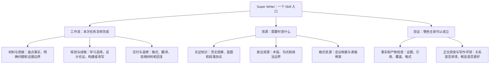

# Super Writer 如何组织、形成与归纳

Super Writer 不是把论文句式拼成提示词，而是把**作者事实、可迁移的写作选择、成稿动作和验证证据**连接起来。
下面按“体系结构、形成过程、单元拆解、条目示例、边界、来源与验证”解释现有系统。
这是对现有文件职责的归纳，不是新增六个运行模块，也不是必须按六步写每篇论文。

## A. 体系结构：工作流与资源分开

[](writer-atlas.html)

[打开交互版](writer-atlas.html)：图中节点链接到实际文件；下方可查看完整规则、条件和正反例。
实线表示写作工作流，虚线表示资源支持或可选评测，红线把问题退回负责阶段。
这些连接不是自动调度器，也不表示 guards 能验证所有科学语义。

分类不是单棵“字典／规范／例子”的树：条目类型区分职责，主题区分读者问题，层级区分
词语到整篇文稿的决策单位。字典是条件用词与技术术语的视图；正反例、理由、条件和
例外跟随同一条目，不另建脱离事实背景的句式库。

形成过程是“一手来源限定阅读 → 记录位置与观察 → 明确本地归纳 → 构造同事实正反例
与合法例外 → 去重并审查准入 → 契约验证”；写作质量仍需另外的冻结盲测。
见 [调研扩充流程](../references/ai-spec-learning.md) 与
[本轮阅读及准入记录](research/ai-spec-expansion-2026-10-13.md)。该流程没有自动定时执行。



| 归纳层 | 它回答什么 | 现有文件职责 |
|---|---|---|
| 工作流 | 给定这份材料，下一步做什么？ | [SKILL 入口](../SKILL.md)按请求路由到 intake、research、contribution、build/rewrite、audit 和交付 playbook |
| 论证资源 | 为什么这样安排内容？ | [范文 dossier](../references/exemplar-learning-dossier.md)、[论证迁移](../references/argument-transfer.md)、[写作理由矩阵](../references/writing-rationale-matrix.md)和[写作协议](../references/writing-protocols.md) |
| 表达与格式资源 | 这个概念怎样说，文档怎样呈现？ | [语言卡](../references/writing-library.md)、[论文蓝图](../references/paper-blueprints.md)、[排版检查](../references/typesetting-validation.md) |
| 验证与反馈 | 事实保住了吗，读者能理解吗，改动真的更好吗？ | `scripts/` 的 guards、[正文读回](../references/argument-transfer.md#read-back-the-claim-before-checking-the-plan)、[盲测流程](../references/blind-evaluation.md)与 `evals/` 的原始记录 |

**工作流不是知识分类，资源数量不是模块数量。** 同一个 Results 单元可以使用论证迁移、结果协议和语言卡，
再接受事实检查；这些不是四套相互替代的写作系统。完整论文需要阶段衔接，局部摘要或段落请求只调用相关部分。

现有资源也使用不同计数单位，不能相加成“顶会模板总数”：

| 资源 | 当前归档量 | 它是什么，不是什么 |
|---|---:|---|
| [语言卡](../references/writing-library.md) | 130 张，其中 78 张句式卡 | 带用法边界的表达资源，不是 130 个官方模板 |
| [本地 AI 写作规格](../references/ai-writing-spec.md) | 19 条规范、15 个主张用词、34 个术语；9 个主题、5 个层级、7 个领域 | 原创条件化条目；来源分开记录一手资料与第三方设计方法，不是行业合规词表 |
| [写作协议](../references/writing-protocols.md) | 16 个协议、30 个变体 | 可调整的章节、段落和表格组织，不是录用论文的固定写法 |
| [表格骨架](../references/table-templates/) | 5 个 | 待填真实材料的 TeX 结构，不是已经完成的实验 |
| [会议档案](../references/venue-profiles.json) | 11 个 | 2026-09-06 核对的归档；目标年份、赛道、阶段的现行规则仍需复查 |

## B. 形成过程：三类输入不能混用

系统的组织来自现有工作流的继承、公开资源的选择性吸收，以及本地范文分析与评测。
具体来源和固定版本见 [UPSTREAM](../UPSTREAM.md)，不是从本页图示推断出来的演进史。

| 输入 | 可形成什么 | 不能变成什么 |
|---|---|---|
| 作者材料：方法、数据、结果、证明、初稿 | 本文事实、证据锚点、贡献与允许的主张范围 | 未做的实验、未证明的性质或作者未确认的动机 |
| 相关优秀论文与公开语言资源 | 对组织选择的观察、条件化的段落结构和表达建议 | 本文的新颖性、数值、机制或结果证据 |
| 官方要求与模板 | 对特定年份、赛道、阶段适用的格式约束 | 所有顶会通用的语气、章节顺序或录用保证 |

对于范文，我们归纳的不是“它有几句话”，而是以下关系：

```text
来源位置与阅读范围
  -> 原文怎样改变读者的理解
  -> 这个安排为什么可能有效
  -> 我们是否有支持该安排的材料
  -> 本文具体解释、对照、移动或限定什么
  -> 成稿中能否恢复这条关系
```

例如，观察到一篇系统论文先说明资源瓶颈，再解释调度操作，不能归纳成“所有方法段落先写瓶颈”。
可迁移的是：**当组件清单无法说明系统怎样工作时，用有材料支持的输入、操作和输出关系连接组件。**
如果作者没有因果实验，就解释设计作用或观察到的结果，不把作用说明升级成已验证的因果结论。

每篇论文的选择仍保存在已有 dossier、style profile 和写作矩阵中，不要求另建项目规则数据库。
可复用的规则和术语另收录于本地 AI 规格，通过同一个查询脚本显式检索；这不是自动归纳引擎。
跨范文的相似选择可以形成更一般的候选指导，但复现次数并不自动使它成为硬规则；
写作质量改动仍需与独立测试材料上的成稿表现分开记录。

## C. 单元拆解：展示关系，而不只是列名字

下面是本项目独立编写的系统说明示例，不是图片原句，也不是写作提升实验。

**只列名称：**

> 系统包括范文学习、蓝图、句式库和审计模块，可以提升写作质量。

**说明怎样配合：**

> 系统先从范文中定位一个解决读者疑问的写作选择，再核对作者材料是否允许迁移。
> 适用的选择进入章节蓝图和写作矩阵，指导具体解释、对照或范围限定；句式库只辅助表达，不提供研究证据。
> 成稿后，写作者先仅凭正文复述主张，再对照材料检查是否丢失关键关系或扩大范围。
> 是否比旧版写得更好，则另用匿名比较判断，不能从矩阵填完或检查器通过推出。

| 句子作用 | 让读者理解的关系 | 必须保留的边界 |
|---|---|---|
| 先定位选择，再核对材料 | 范文学习如何连接本文事实 | 范文事实不属于本文 |
| 选择进入规划，句式辅助表达 | 规划产物怎样指导正文 | 语言资源不是证据库 |
| 仅凭成稿读回，再核对材料 | 为什么正确计划仍需检查实际句子 | 自查不是独立验证 |
| 写作质量另做匿名比较 | 约束检查与质量判断为何分开 | 盲评也不能保证录用或普遍有效 |

学习的是“对象、动作、后果、边界”的可理解关系，不是固定四句模板。
讲一个算法时可以以推导为主；讲数据集时可以以构建、治理与评测协议为主。
没有实际存在的组件或过程，就不能为了完成结构而补写。

## D. 归纳条目：条件、动作、例外与状态一起保存

本页条目是对已有指导与待测问题的示例性整理，不新增语言卡，也不宣称完成自动归纳引擎。
实际学习时复用 [风格学习流程](../references/style-learning-workflow.md#explain-a-system-or-synthesize-a-rule-set)和现有 dossier。
已实现的条件化规格及完整正反例见 [AI 写作规格](../references/ai-writing-spec.md)；
下表的“贡献与证据就近配对”仍是待测假设，没有混入规格成为默认规则。

| 条目 | 何时适用 | 具体动作 | 例外或错误迁移 | 性质与来源 |
|---|---|---|---|---|
| 解释组件的操作关系 | 名称清单不能说明系统怎样工作 | 说明实际输入、操作、输出及它们的依赖 | 没有因果证据时，不称某组件导致全部增益 | 当前条件化指导；[论证迁移](../references/argument-transfer.md) |
| 用区分性对照解释结果 | 多个指标没有回答贡献问题 | 选择能区分合理解释的对照，保留比较预算与范围 | 单个消融不自动证明机制或必要性；重要反向结果不能省略 | 当前条件化指导；[结果验证](../references/results-validation.md) |
| 统一一个概念的指代 | 同一对象的别名使读者误判为不同概念 | 根据本文定义统一指代，再选择表达 | 不合并具有不同定义的近义术语 | 表达建议；[自然学术表达](../references/academic-expression.md) |
| 贡献与各自证据就近配对 | 多贡献摘要把解释集中、证据集中，读者难以配对 | 比较不同安排，观察能否更容易恢复对应关系 | 定理与证明、统一证据、跨贡献对照可能需要别的顺序 | 待测假设，不是新增默认规则；[失败分析](abstract-transfer-evaluation.md) |

一条有用的指导要能回答：**来自哪里、解决什么问题、需要什么材料、怎样写、何时不这样写、现在有什么证据。**
“更清晰”“更学术”不是可执行条目；单独列推荐词，也无法解释论证为什么成立。

## E. 边界：真实性是约束，组织方式是有条件的选择

| 类型 | 怎样处理 | 例子 |
|---|---|---|
| 事实与权限约束 | 不可用风格偏好覆盖 | 不捏造数值、引用、实验、作者确认；不自动投稿或公开私人材料 |
| 官方要求 | 核实适用版本后遵守 | 页数、引用格式、必需声明；归档档案不等于当前投稿许可 |
| 本项目工作约定 | 按请求范围执行，不冒充行业标准 | 产物路径、阶段检查、兼容文件名 |
| 编辑建议 | 根据证据、贡献与读者调整 | 先解释操作关系、减少无解释的表格复述 |
| 开发观察或评测候选 | 标明测试状态，不称为已证明改进 | 多贡献摘要的证据配对；评测快照不自动成为默认指导 |

借鉴用户图片的是**组织说明与示例标注方式**，不是 ASD-STE100 合规规则。
不把技术手册中的句长限额、词表准入或语态限制直接移植到学术论文。
论文中的公式、技术术语、必要的不确定性和条件，不能为追求短句而删掉。

## F. 来源与验证：形成有出处，改进有对照

| 已记录阶段 | 对系统形成的作用 | 可追溯记录 |
|---|---|---|
| 2026-09-05：独立仓库基线 | 从 PaperSpine 衍生工作流与检查器，保持产物兼容 | [基线来源与版本](../UPSTREAM.md) |
| 2026-09-06 至 09-07：选择性吸收 | 整合排版检查思路、自然表达方法、语言卡及协议；保留许可与排除项 | [集成边界](../UPSTREAM.md#selective-integration-audit-2026-09-06)与[资源扩展](../UPSTREAM.md#writing-resource-extension-2026-09-07) |
| 2026-10-10：论证迁移 | 从“观察写法”细化到读者问题、适用证据和正文动作 | [论证迁移指导](../references/argument-transfer.md) |
| 2026-10-11 至 10-12：扩展评测 | 区分局部偏好、事实检查通过与稳定写作提升，保留失败和分歧 | [评测索引](../BENCHMARK.md)、[摘要确认测试](abstract-transfer-evaluation.md) |
| 2026-10-12：组织说明 | 借鉴用户提供的一页概览，整理现有职责与归纳边界 | [本次来源说明](../UPSTREAM.md#system-organization-presentation-2026-10-12) |
| 2026-10-12：AI 写作规格 | 分开规则、条件化字典和术语，生成实际文件职责图；不宣称写作提升 | [规格与来源边界](../UPSTREAM.md#ai-writing-specification-2026-10-12)、[设计决策](designs/adr-001-ai-writing-spec.md) |
| 2026-10-13：证据与长任务边界 | 区分来源／视觉／解释支持及计划／执行／任务链；补充问题导向的结果段 | [来源定位及准入](research/ai-spec-expansion-2026-10-13.md)、[原创对照段落](../examples/ai-writing-spec/grounding-and-horizon.md) |
| 2026-10-13：选择性吸收 STE skill | 按文本用途选择指导，增强定义与指代、补充复现步骤顺序；保留学术例外 | [版本、许可及排除项](research/marmot-ste-integration-2026-10-13.md)、[用途敏感指导](../references/clarity-context.md) |

最近摘要确认测试有 12 组对照：候选 10 票、基线 6 票、持平 8 票。
但一组一致偏好基线，未通过预先规定的门槛；候选仍是实验快照，不能在本页改称默认升级。
软件回归验证检查器和产物约束，不能代替对正文的阅读或写作质量评测。
本系统学习发生在阅读、检索、规划和修订的上下文中，没有训练模型权重。

**组织清楚的最低判断标准：** 读者能说明一个输入怎样进入系统，在哪一步变成写作选择，
这个选择怎样作用于成稿，以及哪一种检查能支持、不能支持最终主张。
